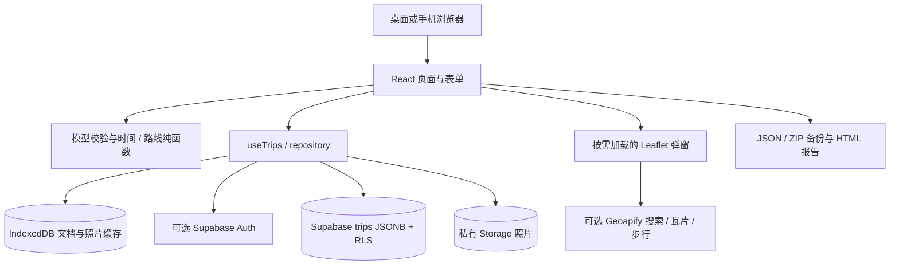

# TripFlow：AI 项目架构与改进指南

适用版本：`package.json` 1.0.0 · 代码快照日期：2026-10-11 · 文档版本：1.0

本文用于让新的 AI 会话或开发者理解现有系统，并在其基础上继续改进。本文描述的是当前实现；第 12 节单独列出的内容是候选改进，尚未实现，也不代表已授权执行。

**使用方法：将本文件与完整项目源码一起提供给 AI。** 只提供本文无法替代阅读代码。发生差异时，以当前代码、数据库迁移、测试和实际运行结果为准，并同步纠正文档。

## 1. 项目目的与产品约束

TripFlow 是个人旅行记录网站。用户建立旅行，再按时间记录地点停留、交通移动、独立照片或随记；每天的视图和地图均从同一份记录计算而来。

核心产品原则：

1. 中文优先，桌面与手机都能使用；奶油色纸面、柔和绿色、单列纵向时间线。
2. 时间线是主要界面，地图按需打开弹窗，不常驻占据半个页面。
3. 先后顺序和时长以真实 UTC 时间为准，允许跨天、跨时区、时间重叠与空白。
4. 如实区分用户填写、在线服务结果和粗略估计；不伪造真实路线、班次、照片或同步状态。
5. 本地模式可独立使用；云端是可选的个人私有空间；用户可导出自己的数据。
6. 支持静态托管到 GitHub Pages，不要求自建 Node 服务。

目前没有公开注册、公开分享、协作编辑、票务或实时交通信息、自动行程规划、GPX / HEIC 支持。新需求若改变以上范围，应明确说明产品与技术影响，避免把候选功能当成已有功能。

## 2. 接手时的阅读顺序

| 顺序 | 文件                                                                                                 | 需要理解什么                          |
| ---- | ---------------------------------------------------------------------------------------------------- | ------------------------------------- |
| 1    | [用户使用说明书](用户使用说明书.md)                                                                  | 实际入口、用户操作及容易误解的行为    |
| 2    | [README](../README.md)、[TESTING](../TESTING.md)                                                     | 启动配置、交付状态、验证边界          |
| 3    | [models/index.ts](../src/models/index.ts)                                                            | 数据结构、引用约束、纯 CRUD、备份版本 |
| 4    | [time.ts](../src/lib/time.ts)、[route.ts](../src/lib/route.ts)                                       | UTC、日界、跨天投影、地图点位来源     |
| 5    | [repository.ts](../src/services/repository.ts)、[useTrips.ts](../src/hooks/useTrips.ts)              | 持久化、账户隔离、版本冲突、缓存      |
| 6    | [EntryForm.tsx](../src/components/EntryForm.tsx)、[App.tsx](../src/App.tsx)                          | 页面交互、时间转换、照片提交顺序      |
| 7    | [MapDialog.tsx](../src/components/map/MapDialog.tsx)、[geoapify.ts](../src/services/geoapify.ts)     | 搜索、路线、坐标约定和失败降级        |
| 8    | [backup.ts](../src/services/backup.ts)、[SQL 迁移](../supabase/migrations/202610110001_tripflow.sql) | 导入重绑定、存储策略、RLS、数据库约束 |
| 9    | [tests](../tests)、[部署工作流](../.github/workflows/deploy.yml)                                     | 可复现验收和部署路径                  |

[ARCHITECTURE.md](../ARCHITECTURE.md) 是简短架构概览；本文补充接手所需的数据流、风险边界和改进方法。

## 3. 运行架构



Vite 构建静态 HTML、CSS 和 JavaScript。React Hooks 管理视图状态；纯函数负责模型、时间和路线；服务层负责网络、浏览器存储和文件。没有 SSR、自建 API 服务、Redux 或后台任务队列。

技术栈以 `package-lock.json` 的精确版本为准，使用 `npm ci` 安装：React 19、TypeScript 5.9、Vite 7、React Router 7、Tailwind 4、React Leaflet 5 / Leaflet 1.9、Luxon 3、Zod 4、Dexie 4、Supabase JS 2、JSZip 3。UI 中 Button 与 Radix Dialog 源码保留在项目内；不是运行时依赖远程组件服务。

### 3.1 文件职责

```text
src/
  main.tsx                      React 挂载与全局样式入口
  App.tsx                       首页、旅行日视图、概览、路由、身份、弹窗协调
  styles.css                    页面、响应式、时间线与打印样式
  models/index.ts               Zod Schema、TypeScript 类型、纯文档操作
  lib/
    time.ts                     UTC 转换、DST、每日裁剪、间隙和重叠
    route.ts                    从同一份记录生成地图点位
    fixture.ts                  用户主动载入的虚构示例及实际示意图片
    utils.ts                    样式合并、错误信息等小工具
  hooks/
    useTrips.ts                 读取与更新当前账户的文档状态
    usePhoto.ts                 私有 Blob → object URL；生命周期结束时回收
  components/
    TripForm.tsx                新建 / 编辑旅行及封面
    EntryForm.tsx               三类记录、独立时区、路线、照片提交
    AuthDialog.tsx              邮箱密码登录；缺配置时提示本地模式
    BackupDialog.tsx            备份下载、导入预检与确认
    Cover.tsx / PhotoView.tsx   插画与照片呈现
    map/MapDialog.tsx           地点选取、单点 / 当日 / 全程地图
    ui/                         Button / Modal
  services/
    repository.ts              IndexedDB、Supabase CRUD、照片读写和缓存清理
    geoapify.ts                 PlaceProvider、搜索、步行缓存、粗估
    media.ts                    图片验证、Canvas 缩放与重编码
    backup.ts                   JSON / ZIP 验证、导出、重绑定导入
    report.ts                   转义后的独立 HTML 报告
supabase/migrations/             PostgreSQL 初始迁移、RLS、Storage 策略
tests/                          Vitest / RTL / PGlite / Playwright
scripts/check-pages.mjs          检查生产入口资源与基础路径
.github/workflows/               PR 检查和 Pages 发布
```

地图通过动态加载按需引入。不要因为一次小改动而把地图依赖重新放回首页的同步加载路径。`App.tsx` 当前承载多个页面级职责，是未来可逐步拆分的区域。

## 4. 数据模型与不变量

### 4.1 一段旅行是一份聚合文档

```ts
TripDocument = {
  trip: Trip;
  places: Place[];
  entries: TimelineEntry[];
  photos: Photo[];
  revision: number;
}
```

这是关系说明，字段定义和验证应直接读 Schema，不要复制本文片段替代源代码。

| 实体            | 关键字段                                                                                                                                                                                    | 含义                                     |
| --------------- | ------------------------------------------------------------------------------------------------------------------------------------------------------------------------------------------- | ---------------------------------------- |
| Trip            | id、ownerId、title、startDate、endDate、defaultTimezone、cover、coverPhotoId、notes、createdAt、updatedAt                                                                                   | 日期范围与日视图时区；封面引用已保存照片 |
| Place           | id、ownerId、tripId、name、address、latitude、longitude、providerPlaceId?、category                                                                                                         | 精确坐标；category 为 place 或 station   |
| TimelineEntry   | id、ownerId、tripId、type、title、startAtUtc、endAtUtc、timezone、endTimezone、地点引用、activityType、notes、transport?、updatedAt                                                         | type 为 stay、transport 或 moment        |
| TransportDetail | mode、operatorName、lineName、boardingStationId?、alightingStationId?、transferNotes、estimatedDuration?、estimatedDistance?、actualDuration、routeGeometry?、routeSource、walkingSpeedKmh? | 作为交通记录的内嵌字段，没有单独的交通表 |
| Photo           | id、ownerId、tripId、entryId、takenAt、storagePath、caption、sortOrder、mimeType、missing?                                                                                                  | 只保存元数据与稳定路径；图片字节独立存储 |

`entryId` 可为 null，但当前界面添加照片通常归属一条活动、交通或 moment。照片的 `takenAt` 来自记录开始时间，不是自动解析 EXIF。日常上传重编码为 JPEG；模型与 ZIP 同时支持 JPEG / PNG / WebP。

### 4.2 修改时必须保留的约束

- ID 使用 UUID，文档内同类列表的 ID 不重复；所有实体的 ownerId / tripId 必须与旅行一致。
- 地点、交通站点、照片所属记录、照片封面的引用必须存在。表单要求停留记录有地点，交通有两端地点，moment 地点可选；不要把 UI 的要求误认为数据库已具有完全相同的类型校验。
- 持续记录结束必须晚于开始；moment 起止相同，表示零时长时间点。
- `transport.actualDuration` 必须与 UTC 起止差的秒数一致；估计耗时不能覆盖实际耗时。
- UTC 字符串需要 `Z` 结尾；时区使用有效 IANA 名称，不保存只有 HH:mm 的时间。
- 记录按旅行默认时区投影后的日期必须落在旅行范围内；持续记录检查结束时使用 `end - 1ms`，避免午夜结束误落次日。
- 旅行首尾包括在内，最多 366 天。修改日期或默认时区后应重新验证整份文档。
- 照片路径绑定为 `ownerId/tripId/photoId`，不得使用备份里的任意外部路径作为新账户上传目标。
- `routeGeometry` 是 GeoJSON MultiLineString，坐标为 `[longitude, latitude]`；有几何时来源应为 `gps` 或 `geoapify`。
- 当前 Schema 每文档上限：10000 个地点、20000 条记录、5000 张照片元数据。备份最多 100 段旅行；数据库单份 JSONB 文档文本上限为 10 MiB。

`upsertEntry`、`removeEntry` 等纯函数集中处理文档变更和引用清理。删除记录会清理其照片元数据并解除相关封面引用；图片字节的删除由服务层完成。

### 4.3 实际数据库不是多张业务表

```text
public.trips
  id          uuid，主键
  owner_id    uuid，关联 auth.users
  data        jsonb，整份 TripDocument
  revision    integer，正数版本
  created_at / updated_at

Storage: tripflow-photos（private）
  <auth.uid()>/<tripId>/<photoId> → 图片字节
```

地点、记录和照片元数据嵌入 `data`，没有 `places`、`entries`、`photos` 或 `days` SQL 表。每天只是投影视图，不是需要另存的实体。

这种设计使单段旅行的元数据可以原子更新，适合当前个人规模。代价是每次修改写整份文档、同一旅行内不同记录也会竞争同一个版本，列表读取当前没有分页。不能在小改动中假定已存在规范化关系表；若未来拆表，需要单独设计迁移、事务、查询和备份兼容方案。

## 5. 时间逻辑：最容易发生回归的部分

### 5.1 从表单到存储

```text
当地完整日期时间 + IANA 时区 + 必要时的 DST 偏移
  → toUtc 校验
  → startAtUtc / endAtUtc
  → 按 UTC 排序、计算真实秒数
  → 按旅行默认时区投影到某日
```

开始和结束时区独立保留。跨时区航班不能拿显示钟点直接相减。`toUtc` 拒绝夏令时跳变中不存在的当地时间；重复时间通过偏移选择消除歧义，不能让日期库静默替用户选一个。

### 5.2 每日区间

`dayBounds` 使用旅行时区的午夜到下一日午夜，区间为 `[start, end)`。下一日通过日历加一天取得，不能写死 `24 * 60 * 60 * 1000`，因为夏令时日可能为 23 或 25 小时。

`dailyEntries` 对持续记录做区间相交与裁剪，moment 按时间点归属。跨天记录只存一条，可在多天显示；当日时长是裁剪后的差值，全程时长取原记录。午夜结束不额外出现在次日。

`sorted` 以 startAtUtc 排序，同起点用 ID 稳定排序。`timelineRows` 计算间隙与重叠时维护最大已占用边界，避免长住宿中穿插短活动后出现假间隙。`totalDuration` 统计各记录原始时长，不对重叠区间求并集。

时间相关修改至少检查：跨午夜、结束恰为午夜、跨时区、春秋 DST、嵌套重叠、独立时间点、改变旅行时区和缩小日期范围。现有用例在 `tests/time.test.ts`、`tests/model.test.ts`。

## 6. 状态、持久化与账户切换

### 6.1 本地模式

`LOCAL_OWNER = 'local-demo'`，Dexie 数据库名为 `tripflow-v1`：

| IndexedDB 表 | 主键 / 内容                                               |
| ------------ | --------------------------------------------------------- |
| documents    | key = `ownerId:tripId`，另有 ownerId 索引，内容为整份文档 |
| attachments  | path 主键，内容为 Blob                                    |

本地保存是主要数据写入，不是可忽略的缓存。保存文档时在 IndexedDB 事务中比较旧 revision；发生另一窗口修改会报冲突。当前本地整旅行删除没有同等版本保护，不要将云端删除的保护能力套用到本地实现。

站点来源改变会换一套浏览器存储；没有 Service Worker / 完整 PWA 离线启动机制。清理站点数据会删除本地旅行。

### 6.2 云端模式与缓存

配置 Supabase URL 与 Publishable Key 后创建客户端；登录使用邮箱密码，用户账户在 Supabase 后台建立，没有公开注册 UI。无登录会话时仍使用本地模式。

`useTrips` 先读当前 owner 缓存，再查询云端；generation token 丢弃过期读取结果，loadedOwner 避免账户切换时显示旧账户的文档列表。云端查询失败回退到缓存，并标记只读。

```text
读取：账户切换 / 页面加载 → 当前账户缓存 → 云端查询 → 校验 → 替换状态与缓存
保存：整文档校验 → 比较版本并提交主要存储 → 更新可选缓存 → 更新 React 列表
```

云端写入成功后，浏览器缓存失败不能把成功保存报告成失败。云端是主要数据源；IndexedDB 配额耗尽时应尽可能保持该语义。

readonly 条件为云端账户且浏览器离线或当前数据来自失败回退缓存。本地模式可以离线编辑。恢复网络只更新在线状态，不自动重新加载远端文档；无 Realtime 订阅、离线写入队列或冲突自动合并。

登录不把 `local-demo` 数据自动上传，迁移方式是本地导出完整 ZIP、登录后导入。主动退出清除该云端账户的本地文档与照片缓存；缓存没有客户端磁盘加密。

后续若新增异步流程，继续检查“切换账户后，旧请求结果能否回写新账户 UI”。读取与保存已有防护，不代表所有未来操作天然安全。

### 6.3 revision 乐观并发控制

新文档 revision 为 0；持久化后递增为 1。已存在文档执行带旧 revision 条件的更新，新 revision 为旧值 + 1。返回零行表示冲突，禁止无条件覆盖。

数据库触发器约束 revision 逐次递增以及 id、owner、created_at 等身份字段不可更改。云端整旅行删除也带 revision 条件。照片不属于该数据库事务，因此还需要下一节的补偿和不确定状态处理。

冲突时表单保留输入，用户保管未保存内容、刷新读取最新版本，再重新应用修改。当前没有差异对比、三方合并或“强制覆盖”按钮。

## 7. 照片提交与故障语义

### 7.1 正常流程

```text
用户选图
  → 类型 / 原图大小 / 解码像素检查
  → Canvas 最长边 1800px、JPEG 质量 0.82、白底、去 EXIF
  → 表单中暂存 Blob 与说明
  → 用户点击保存
  → 先 putPhoto 上传 / 写入新图片
  → 再保存包含图片引用的 TripDocument
  → 最后删除不再引用的旧图片
```

普通上传支持 JPG / PNG / WebP，原图最多 20 MB，解码图片有像素上限，每记录最多 12 张。Storage 允许的文件为 JPG / PNG / WebP、单张最多 8 MiB。

照片读取由 `getPhotoBlob` 优先查缓存，再用已认证 Storage download 下载，通过 `usePhoto` 创建 object URL。URL 及时回收；JSON 中只存稳定路径，不保存 object URL、公开链接或会过期的签名链接。

### 7.2 不能误删的情况

Storage 与数据库不具备分布式事务。提交前失败或本地文档保存失败时，对本次新上传图片做补偿清理；云端保存请求若已发送后报错，服务器可能已经提交成功而响应丢失，因此保留新图片并提示刷新核对。

`EntryForm` 的 stagedUploads 在同一个编辑窗口里记录已上传 ID，重试可复用。它不是持久化草稿，关闭窗口后无法依靠它恢复。异常退出可能留下私有孤立对象；删除流程也可能出现元数据已提交、图片清理失败的警告。

不要把所有未看到的对象一键删除。未来清理工具应先枚举全部有效引用、考虑在途上传和保留窗口，输出 dry-run 清单，再按精确路径清理。此工具当前尚未实现。

## 8. 地图、地点与路线

### 8.1 Provider 边界

`services/geoapify.ts` 中的 PlaceProvider 暴露 search / walk。换地图提供商应在此边界适配，避免把新响应结构散落到表单、模型与地图组件。

- 自动补全：中文 / 英文 / 日文，输入至少两个字符，450ms 防抖，取消旧请求，15 秒超时。
- 步行：只有用户点击“计算步行”才请求；成功结果按参数保存在内存缓存，最多 100 项，不跨页面重启持久化。
- 在线请求和缓存键使用起终点坐标，没有把自定义速度传给 Geoapify；速度仅参与直线降级估算。若未来支持在线速度调整，应同时改接口语义、缓存键、说明与测试。
- 失败 / 缺 Key：haversine 直线距离除以配置速度，明确标为粗估，不生成伪道路几何。
- 修改步行起终点、方式、速度会清掉旧估计。估计不会自动回填结束时间。
- 复用地点来自当前用户已加载的旅行，确认后使用当前旅行的地点实体；没有独立的“收藏夹”数据库表。
- 修改坐标后清除可能失配的 providerPlaceId。交通站点以 place.category 判断，不应把所有交通端点都画成车站。

无 Geoapify Key 时不请求真实瓦片和在线搜索，只显示可操作坐标网格。没有接入公共 Nominatim 自动补全。

### 8.2 坐标约定必须明确

| 场景                                                   | 顺序 / 单位                   |
| ------------------------------------------------------ | ----------------------------- |
| Place 字段                                             | latitude、longitude，分别存储 |
| GeoJSON 存储和 GPS 导入                                | `[longitude, latitude]`       |
| Leaflet LatLng                                         | `[latitude, longitude]`       |
| Geoapify routing waypoints 参数                        | `lat,lon\|lat,lon`            |
| estimatedDistance / estimatedDuration / actualDuration | 米 / 秒 / 秒                  |
| 表单手填估计耗时                                       | 分钟，写入时转换为秒          |

GPS 导入接受最大 2 MB 的 LineString / MultiLineString 或对应 Feature，归一为 MultiLineString；不支持 FeatureCollection / GPX 自动转换，也没有沿线时间戳模型。不会自动从几何反算实际时长。

### 8.3 地图与时间线是同源投影

`route.ts` 从 `dailyEntries` 或全程排序记录生成点位；交通取起终点，其他记录取关联地点。缺地点的 moment 不生成点。相邻的同一端点会合并，可能隐藏连续重复访问的独立编号，但原时间线记录保留。

棕色虚线只示意访问顺序；绿色实线来自 Geoapify 道路几何；紫色实线来自用户 GPS。无真实轨道 / 航线数据时不伪装铁路或飞机路径。

每日地图中的跨天交通仍显示全段几何，弹窗注明。当前几何没有逐点时间，不能靠按点数平分就声称精确完成午夜裁剪。地图弹窗可返回对应日的记录，按点 fitBounds / 聚焦。

## 9. 备份、导入与报告

### 9.1 格式

```text
JSON:
  format: "tripflow"
  version: 1
  exportedAt: UTC
  documents: TripDocument[]

ZIP:
  tripflow.json
  photos/<旧 photoId>          实际图片字节，不是链接文本
```

JSON 不含图片字节；其导入结果标记 missing。ZIP 导出必须读取全部照片，缺图就失败。当前 UI 导出当前账户全部已加载旅行，不提供选择单旅行 / 分批工具。ZIP 在内存中生成，不能承诺处理无限规模数据。

`readBackup` 检查 Zod 模型、文档引用、文件白名单、图片签名与 MIME，以及 ZIP 中央目录解压大小。当前限制：导入文件 100 MiB、单个 ZIP 项目 10 MiB、解压总计 200 MiB、最多 5001 项、单张图片 8 MiB。限制均应在改动时查看代码实值。

### 9.2 导入语义

`rebindDocument` 为旅行、地点、记录、照片生成新 ID，重写所有引用、ownerId / tripId 和照片路径，revision 重置为 0，绑定当前账户。禁止信任输入文件指定的目标账户或上传路径。

导入始终新增，不覆盖、不去重、不补齐旧旅行的缺图引用。重新导入完整 ZIP 会得到新的完整副本。

多旅行逐段保存；单段元数据原子，整次导入不是全有或全无。失败提示“已确认导入”的数量，最后一段还可能出现云端结果不明，需要刷新核对。重试整个文件可能重复已经成功的旅行。

### 9.3 报告

`reportHtml` 逐字段转义用户输入，使用禁止脚本和外部资源的 CSP。HTML 为可读报告，包含照片数量说明，不嵌入图片或地图截图；打印概览使用 print CSS。HTML / PDF 不是可还原备份，不要复用 HTML 导入执行内容。

## 10. 权限与部署边界

### 10.1 访问控制

Supabase `trips` 通过 owner RLS 限制 CRUD，SQL 检查文档形状及内部 owner / trip / storagePath 绑定，但它并未完整重现前端 Zod 的时间与所有引用校验。新增绕过前端的写入入口时，应补上服务器校验设计。

`tripflow-photos` 为 private bucket。对象策略校验首级目录为 auth.uid()，限制路径格式及图片类型 / 大小；它不是与每份 trips 元数据建立外键的照片表。当前允许先上传后创建旅行，所以不能简单新增“旅行必须已存在”的规则而不改提交顺序。

前端 `VITE_` 配置会进入公开构建：

| 变量                          | 用途                                   |
| ----------------------------- | -------------------------------------- |
| VITE_SUPABASE_URL             | Supabase 项目 URL                      |
| VITE_SUPABASE_PUBLISHABLE_KEY | 浏览器 Publishable Key，权限依靠 RLS   |
| VITE_GEOAPIFY_API_KEY         | 浏览器地图 Key，使用来源限制与配额管理 |
| VITE_BASE_PATH                | 静态资源基础路径                       |

禁止前端使用 Service Role、数据库密码和 Supabase Secret Key。代码有 `sb_secret_` 前缀检查，但不代表它能识别所有格式的特权凭据；不要依赖前缀检查替代配置审查。用户照片、备份和 `.env` 不应提交 GitHub。

### 10.2 静态部署与路由

使用 HashRouter：`/tripflow/#/trip/<id>?date=YYYY-MM-DD`。Hash 内的路由不需要 Pages 配置服务器 fallback。Vite 本地默认 base 为 `/tripflow/`；正式工作流按仓库名生成 `/<repo>/`，`USERNAME.github.io` 仓库使用 `/`。

修改环境变量后需要重启开发服务或重新构建。不要直接双击 dist/index.html；必须经 HTTP 提供 ES 模块资源。

部署工作流在 main 推送或手动触发后执行依赖安装、单元测试、浏览器测试、正式构建、路径检查与 Pages 发布。需要仓库 Pages Source 已选择 GitHub Actions；公开变量在仓库 Actions Variables 中设置。PR 工作流做检查。完整操作见 README。

截至本文快照，已提供工作流和本地构建产物，但未获得 GitHub 仓库授权、未推送、未运行远端 Actions、未发布真实站点。以后接手应检查实际状态，不要把这句话当作永远不变，也不要凭配置文件推断已经上线。

## 11. 测试基线与可信度

下表为 2026-10-11 的既有验收记录，不表示以后修改后仍自动通过。本文编写只修改文档，未重新执行业务测试。

| 层次              | 既有结果                        | 能证明与不能证明的内容                                         |
| ----------------- | ------------------------------- | -------------------------------------------------------------- |
| Vitest / RTL      | 32 项通过，8 个文件             | 时间、模型、CRUD、表单、地图模拟、备份、数据库策略             |
| PGlite            | 上述 32 项中包含 3 项数据库测试 | 实际 PostgreSQL 运行迁移和 RLS；Auth / Storage 元表为测试 stub |
| Playwright        | 4 项通过，桌面 / 手机各 2 项    | 生产构建上的交互、刷新持久化、照片、备份、子路径等             |
| TypeScript / Vite | 通过                            | 类型检查与本地生产构建                                         |
| Pages 路径        | `/tripflow/` 与 `/` 检查通过    | 入口资源存在及 Hash 路由刷新；不代表远端部署成功               |

地图接口使用模拟响应；真实 Supabase 登录、Storage、两设备读写、Geoapify 与 GitHub 托管部署仍需凭据验收。移动测试是 Chromium 触摸与视口模拟，不等于实体 iPhone / Safari 验收。

### 11.1 常用验证命令

在项目根目录按需要选择命令，Node 最低 22.12，现有环境使用 Node 24。`npm run dev` 会持续运行，其他检查可在另一终端执行：

```sh
npm ci
npm run dev
npm run check
npm test
npm run build
npm run check:pages
npx playwright install chromium
npm run test:e2e
```

E2E 自动构建并启动隔离测试服务器（4173 端口），明确清空第三方配置，使用本地模式，不应写入私人云端数据。有系统 Edge / Chromium 时可用 `PLAYWRIGHT_EXECUTABLE_PATH` 指定路径，示例见 TESTING。不要为文档小改动无必要地重跑整套业务测试；行为变更则按影响运行对应检查。

### 11.2 改动与检查的对应关系

| 改动区域               | 至少检查                                                                     |
| ---------------------- | ---------------------------------------------------------------------------- |
| 时间、日期、排序、统计 | time / model 单元测试，跨午夜和 DST 边界，相关日视图流程                     |
| 字段、引用、删除       | model / repository / backup，实际保存刷新与导入往返                          |
| 照片提交或补偿         | 保存失败、结果不明、重试、删除封面图、ZIP 图片恢复                           |
| 地图 Provider / 坐标   | geo / map 测试，选择结果到 Marker 的坐标，服务失败降级；有配置时真实接口验收 |
| 账户、缓存、并发       | 账户切换、断网只读、旧 revision 冲突；真实云端两账户 / 两设备验证            |
| SQL / Storage 策略     | database 测试、迁移可重复升级路径、真实 Supabase 最小权限验收                |
| 路由、构建或页面布局   | 生产构建、check:pages、对应 E2E、手机视觉和横向溢出                          |

线上验收具体步骤已在 TESTING 中列出。报告结果时写清“本次运行”“历史记录”“模拟接口”和“尚未运行”，不要用测试数量掩盖未验证的外部服务。

## 12. 候选改进路线

以下是基于当前实现提出的下一步选项。优先级是建议，不要求一次全部做完。

| 优先级 | 候选改进                                   | 主要影响文件                        | 可验收的完成标准                                                                 |
| ------ | ------------------------------------------ | ----------------------------------- | -------------------------------------------------------------------------------- |
| P0     | 配好真实云端与地图服务，完成上线前集成验收 | .env 配置、SQL、TESTING、部署工作流 | 两账户隔离、两设备读写 / 冲突、真实照片、真实搜索 / 路线、Pages 地址逐项有结果   |
| P1     | 未保存提醒与可恢复草稿                     | EntryForm、TripForm、App、IndexedDB | 刷新 / 关闭提示明确；如实现草稿，按 owner 隔离、退出妥善清理，且不冒充已保存数据 |
| P1     | 安全的“重新读取云端”入口                   | App、useTrips                       | 有未提交编辑时保留或提示；读取后获得新 revision，不偷偷覆盖输入                  |
| P1     | 点击空白时段加号自动预填该间隙             | App、EntryForm                      | 开始 / 结束均来自点击的间隙，跨午夜与时区正确，原新增入口不回归                  |
| P1     | 拆分 App.tsx 的页面级组件                  | App、新页面组件、相关 Hooks         | 保持路由和操作行为，避免同时改变模型；原 E2E 通过                                |
| P1     | 导入预检与部分成功恢复体验                 | BackupDialog、backup                | 用户能看清旅行清单、重复风险、已导入部分；不以标题相同直接覆盖                   |
| P2     | 地点 / 线路历史的可搜索交互                | EntryForm、MapDialog                | 手机操作稳定，明确当前旅行与历史来源；保持键盘可用                               |
| P2     | 孤立图片检查与清理工具                     | repository、独立维护工具            | 先只读输出引用和候选文件，排除在途上传；精确清理后正常照片仍可读取               |
| P2     | 大数据备份与单旅行选择导出                 | BackupDialog、backup                | 能选择旅行、显示容量、受控失败；若超限方案变化，同时修改导入与文档               |
| P2     | GPS 按时间分段与更精确每日路线             | 模型、route、MapDialog、backup      | 先加入可验证的时间信息和迁移，再测午夜裁剪；不根据点序号宣称精确时间             |

不要为上表提前大规模升级依赖、拆关系表或引入后端。当前静态架构能满足的需求，优先在现有边界内实现。若需求确实涉及后台任务、服务端私密密钥或大规模查询，再单独论证新的服务边界。

## 13. 持续改进的工作规则

### 13.1 每次接手先确认事实

1. 阅读本指南、用户说明、README 与 TESTING，再打开相关实现和用例。
2. 检查当前目录、版本控制状态和用户已有修改；本交付包未预设已有远端仓库，不凭空假定 main、origin 或线上环境存在。
3. 复现具体问题，或将新需求整理成可观察的完成标准。能从现有上下文判断的常规实现选择直接处理，不重复询问已经明确的授权。
4. 标明涉及 UI、模型、持久化、照片、备份、数据库或部署中的哪些层，控制变更范围。
5. 完成修改、适当验证、更新文档，并给出具体结果与尚未验收项。

### 13.2 新增字段的检查顺序

```text
模型与默认值
  → 表单输入 / 显示
  → 文档 CRUD 与引用校验
  → repository / SQL 约束（若相关）
  → 旧数据兼容与备份读取 / 导出 / 重绑定
  → 报告和统计（若相关）
  → 测试与两份文档
```

新可选字段不一定需要立即改变备份版本，但必须实测旧 v1 文件仍可读；破坏格式的修改需要明确版本与升级函数。不要默默改变 version 1 的含义。已有云端数据库的升级使用新的 SQL migration，不能覆盖初始迁移后要求用户重复运行。

IndexedDB 结构修改同样需要 Dexie 版本升级与迁移。照片路径 / 账户绑定的变更要同步修改 Storage 策略、导入重绑定和清理逻辑。改动前保留可恢复备份，不使用用户私人数据作为自动化测试样本。

### 13.3 明确避免的回归

- 按本地显示时间排序，或跨时区直接相减。
- 把一天固定成 24 小时，或为跨天显示复制原记录。
- 把估计耗时写成实际耗时，把示意线画成真实道路。
- 云端断网时悄悄允许写缓存并显示同步成功。
- 无条件覆盖 revision，或新建请求绕过当前 owner 校验。
- 在云端结果不明时删除可能已被元数据引用的照片。
- JSON 备份声称包含实际照片，或报告文件声称能还原旅行。
- 将外部备份里的 ownerId / storagePath 直接作为新账户写入目标。
- 公开私有 bucket，或把特权密钥、个人照片、私人备份写入前端 / Git 仓库。
- 把模拟接口、PGlite stub 或手机视口测试表述为真实服务 / 实体设备验收。

## 14. 可以直接交给下一位 AI 的提示词

复制下方文字，并将具体改进填写在最后一行，同时提供当前完整源码：

```text
你正在接手 TripFlow 个人旅行时间线网站。先阅读 docs/AI项目架构与改进指南.md、
docs/用户使用说明书.md、README.md、TESTING.md，再检查相关源代码和测试。
文档是快照；如与代码不一致，以当前实现和实际验证为准，并修正文档。

请在现有项目上完成下面的具体改进，保留中文、单列时间线、地图按需打开、
真实 UTC 时间、账户隔离、版本冲突保护、私有照片以及备份可恢复性。
检查已有修改，避免覆盖无关工作。先说明目标行为和受影响模块，再完成实现。
涉及模型时检查旧数据、备份重绑定、日期投影和必要的数据库迁移。
使用最小必要改动；不要顺便重写系统或批量升级依赖。

运行与改动相关的验证，报告实际运行结果。没有凭据时明确哪些线上能力
尚未验收，不编造 API 结果、部署地址或同步成功。更新操作说明与架构指南中
受影响的内容，最后说明改了什么、如何验证、还有哪些具体限制。

本次要完成的改进：[填写具体需求、期望行为和验收标准]
```

## 15. 文档维护约定

功能入口或操作变化：更新用户说明；模块、模型、数据流、异常行为、迁移或候选计划变化：更新本指南；启动、配置或部署变化：更新 README；验证结果变化：更新 TESTING，并写清日期和环境。

本文所有源码链接采用项目内相对路径，便于整个文件夹或 ZIP 交给其他 AI。维护时更新文档顶部的适用版本与快照日期，不把历史测试结果改写成未经执行的新结果。
